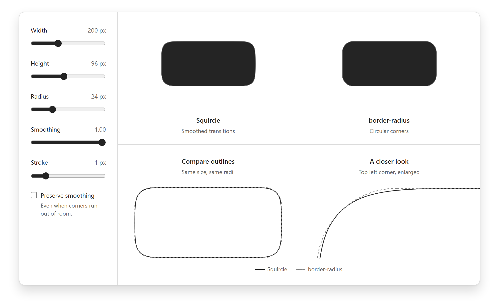
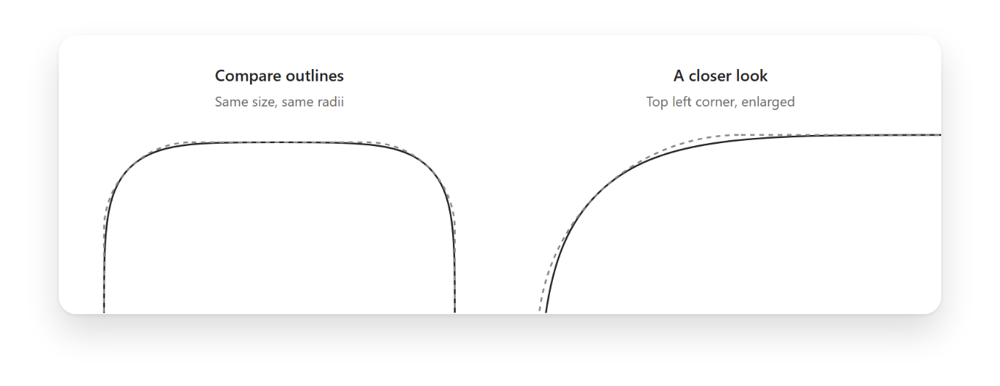

# squircles

[](https://www.npmjs.com/package/squircles)
[](https://github.com/eiserv/squircles/actions/workflows/ci.yml)
[](https://www.npmjs.com/package/squircles)
[](https://github.com/eiserv/squircles/blob/main/src/index.ts)
[](LICENSE)

Figma-style corner smoothing for the web. Backgrounds, borders, shadows, and hover
states stay in your CSS. No extra wrapper, optional React and Svelte integrations,
and no runtime dependencies in the geometry or DOM packages.

<p align="center">
  
</p>

## Install

```sh
npm install squircles
```

## One stylesheet, several ways to use it

```css
.button {
  background: #242424;
  color: white;
  border: 1px solid #666;
  border-radius: 12px;
  --squircle-smoothing: 1;
  padding: 12px 20px;
}
```

**React** (18 or later):

```tsx
import { Squircle } from "squircles/react";

<Squircle as="button" type="button" className="button">
  Learn more
</Squircle>
```

**Svelte** as an [action](https://svelte.dev/docs/svelte/use):

```svelte
<script>
  import { squircle } from "squircles/svelte";
</script>

<button class="button" use:squircle>Learn more</button>
```

**JavaScript, Vue, or other frameworks** through the DOM entry point:

```ts
import { applySquircle } from "squircles/dom";

const element = document.querySelector<HTMLElement>(".button");
const cleanup = element ? applySquircle(element) : () => {};
// Call when the element is removed.
cleanup();
```

The integrations read `border-radius` and `--squircle-smoothing` from CSS.
Class, style, and size changes, along with hover and focus, update the shape.
Server-rendered elements initially use their ordinary CSS radius.

## Geometry only

```ts
import { createSquirclePath, createSquircleClipPath } from "squircles";

const options = { width: 200, height: 96, radius: 24, smoothing: 1 };
const path = createSquirclePath(options);
const clipPath = createSquircleClipPath(options);
```

`radius` supports individual corners; `smoothing` ranges from `0` to `1`.
When space is limited, smoothing is constrained as in Figma.
`preserveSmoothing: true` keeps it by compressing the control points.
`inset` moves the path inward, for example by half an SVG stroke width.

<p align="center">
  
</p>

## Limits and more examples

- Borders must be solid and uniform; different borders per side are not supported.
- Focus outlines and inset shadows still follow `border-radius`.
- Images and inputs receive a clip path that also clips their border and shadow.
  Use a wrapper when needed.
- For semi-transparent borders, use `SquircleSurface` from `squircles/react`.
- Without `ResizeObserver`, measurement runs on startup and window resize.
  Other layout changes require a polyfill.

[Integration, options, and migration](docs/integration.md) ·
[Architecture and limits](docs/architecture.md)

## Development

```sh
npm ci
npm run check
npx playwright install chromium
npm run test:browser
npm run playground
```

Playground: [localhost:5173](http://localhost:5173/), React:
[localhost:5173/react](http://localhost:5173/react/), Svelte:
[localhost:5173/svelte](http://localhost:5173/svelte/).
`npm run screenshots` regenerates the README images with transparent shadows.
`npm run visual:fixture` creates more geometry examples in `.artifacts/`.

Commits on `main` follow [Conventional Commits](https://www.conventionalcommits.org/).
release-please opens a release PR; merging it publishes the npm package.
